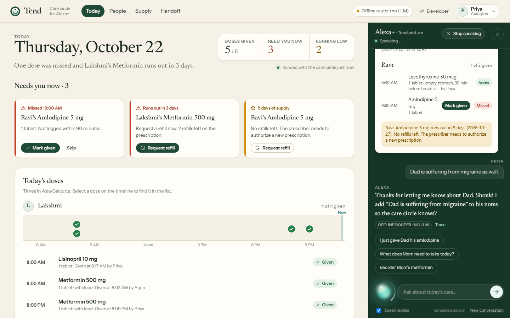
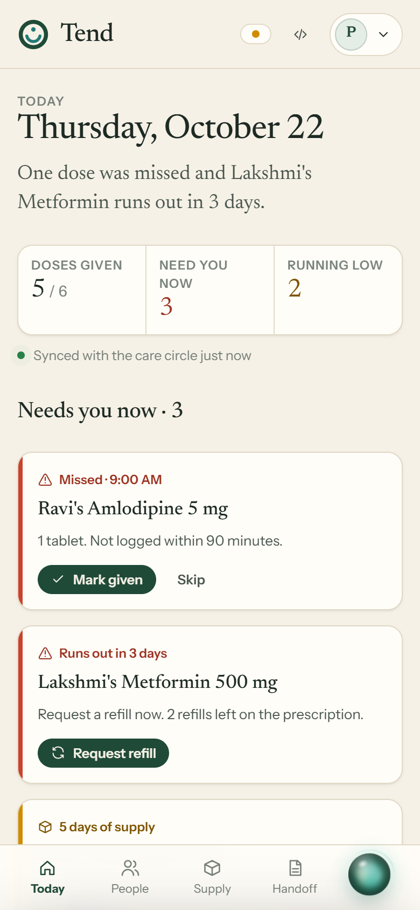
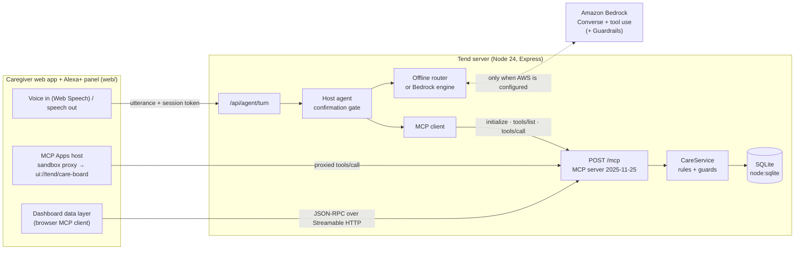

# Tend

**A shared, voice-first care record for families looking after a parent, built as an add-on for Alexa+.**

Tend is a self-hosted [Model Context Protocol](https://modelcontextprotocol.io) server (spec **2025-11-25**, **Streamable HTTP**). Alexa+, the caregiver web app and any other MCP client read and write the same care record through the same 13 tools. The server enforces the safety rules, so they hold no matter which client or model is calling.

> Amazon Developer Hackathon 2026 ("Build, Ship, Shape") · Primary track: **Alexa+** · Mini challenge: **AWS Builder**



---

## The problem

When two or three siblings share care of a parent, nobody has the full picture:

- *"Did Mom already take her evening metformin? Arjun was there at 8…"* This can lead to a **missed or doubled dose**.
- *"When do we run out of Dad's amlodipine?"* Someone notices on the last pill, and the prescription has **no refills left**.
- *"How was Dad this week?"* Observations live in a group chat and get lost before the doctor visit.

These questions get asked in the kitchen, often with your hands full. Tend gives Alexa+ one persistent memory for the whole care circle, and the guardrails to act on it safely.

## What you can say

| You say | What Tend does |
|---|---|
| "Did Dad take his pills?" | Answers from what was logged, short answer first: *"Partly. His 6:30 AM Levothyroxine was logged as given at 6:47 AM by Priya. The 9 AM Amlodipine hasn't been logged, so I can't confirm he took it."* |
| "I just gave Mom her metformin" | Logs the dose against the right scheduled slot and decrements stock. **If a sibling already logged that dose, it refuses and says who logged it and when.** |
| "When will we run out of anything?" | Forecasts the runout date from stock and schedule, and flags prescriptions with no refills left. |
| "Reorder Mom's metformin" → "Yes" | Prepares the request, reads it back, and records it only after a yes in a **later** turn. Then it drafts the message to the pharmacy. |
| "Dad is suffering from migraine" | Asks *"Should I add 'Dad is suffering from migraine' to his notes?"* and saves only after a yes. |
| "Give me the handoff for this week" | Adherence, missed doses, notes, low supply and open refills, ready for the next caregiver or a doctor visit. |
| "What does Dad take?" | Lists his medicines, doses and times from the record. |

## What makes Tend different

A medication tracker records one person's doses, and a chatbot answers questions. Tend is the **shared, attributed record a care circle coordinates through by voice**, with the rules enforced on the server rather than in a prompt:

- **Siblings can't double-dose Dad.** `log_dose` refuses a second "taken" for the same slot and names who logged the first one (`src/domain/care.ts`). This holds for every MCP client, including a model that misunderstands.
- **The model can't approve its own actions.** Refills are two-phase. The host blocks `confirm_action` unless the user said yes *in this turn* to something offered *in an earlier turn* (`src/agent/agent.ts`).
- **Roles are structural.** A view-only visiting nurse's MCP session never lists the write tools at all (`src/mcp/server.ts`).
- **Every record names who made it.** Doses, notes and refills are attributed to the caregiver's own identity.
- **Honest about uncertainty.** A dose counts as given only if it was logged. The caregiver's own feelings ("I'm sad", "nah, it's just my feeling") are never filed as a patient note, and observations about Mom or Dad are saved only after a yes.
- **No medical advice.** Questions about changing, skipping or doubling doses are declined and pointed to the pharmacist or doctor.

## Try it

**Requirements:** Node.js **24+**. Tend uses the built-in `node:sqlite` and native TypeScript type stripping, so there's no build step. Use Chrome or Edge for voice input; typing works in any browser. AWS is optional.

```bash
git clone <repository-url> tend && cd tend
npm install
npm start
```

Open **http://127.0.0.1:8787**. The first start creates a demo household:

- Lakshmi ("Mom") and Ravi ("Dad"), the parents being cared for;
- **Priya** and **Arjun**, the caregivers;
- **Nurse Maria**, view-only;
- a week of realistic history.

Use the orb to speak, or type in the Alexa+ panel. A two-minute tour:

1. "Did Dad take his pills?"
2. "When will we run out of anything?"
3. "Reorder Mom's metformin" → "Yes, go ahead"
4. Open a private window, switch the caregiver menu to **Arjun**, and press *Mark given* on a dose Priya already logged. The double-dose guard stops it and names Priya.
5. "Hey, I am sad." → "Nah, it's just my feeling." → "Dad is suffering from migraine as well." → "Yes". Only Dad's observation is saved.
6. "Give me the handoff for this week"
7. Switch to **Nurse Maria** and try to log a dose. It's refused, because she's view-only.

`npm run seed` resets the demo data. Settings are environment variables (see [Configuration](#configuration)). Copy `.env.example` to `.env` only if you want to change them. Note that the example file sets `TEND_TIMEZONE=America/Los_Angeles`.

## The assistant: offline router or Amazon Bedrock

Every turn runs the same pipeline:
1. The browser sends the utterance.
2. The host agent opens a real MCP session as that caregiver (`initialize` → `tools/list`).
3. An engine chooses the tools.
4. Each call is a real `tools/call`, through the host's confirmation gate and the server's permissions and guards.
5. The reply comes back as display text plus a spoken form.

The engine is chosen by `TEND_AGENT_ENGINE` (default `auto`). The header shows which one is active, and each reply is labelled with the engine that actually produced it.

**Offline router: the default, with no language model.** It is deterministic, not generative, and the UI says so ("Offline router (no LLM)"). `src/agent/intent.ts` classifies intent and extracts people, family words like "Mum", medicines, times and days. `src/agent/offline.ts` manages the conversation:
- **Answers:** narrow, short answer first, composed only from tool results.
- **Clarifies:** asks one short question when a request is vague or ambiguous, never guesses who a write is for, and confirms hedged statements ("she probably took it") before logging.
- **Context:** follows up ("And Dad?", "What about tomorrow?") and handles corrections ("No, I meant Mom").
- **Topic changes:** a new request mid-clarification is handled on its own, not swallowed by the old question.
- **Caregiver feelings:** answered supportively, never recorded. Crisis language gets emergency guidance (988 in the US).
- **Medical advice:** declined, including missed-dose "what should I do?" questions, which get the record plus a pointer to the label or pharmacist.
- **Off-topic requests** (weather, music, timers) get a clear boundary.

**Amazon Bedrock: when AWS credentials are present.** The model drives the same MCP tools through the Converse API with tool use (`src/agent/bedrock.ts`). The system prompt carries the same conversational rules. Safety doesn't depend on the model: the host enforces confirmations, and the server enforces permissions and the double-dose guard. In `auto` mode, a Bedrock error falls back to the offline router for that turn, and the reply is labelled accordingly.

> **Status:** the Bedrock integration is implemented and covered by tests against a scripted mock Converse client, including a model that tries to confirm its own refill and is blocked. It has **not yet been run against live Bedrock** in this repository. See [Using Amazon Bedrock](#using-amazon-bedrock) to verify it with your account.

## Hackathon requirements

### Alexa+ track
- **Self-hosted MCP server**, protocol `2025-11-25` (negotiated in `initialize` and asserted in tests), over **Streamable HTTP** at `POST /mcp`. It's built on the official `@modelcontextprotocol/sdk` (`src/mcp/server.ts`, `src/http/app.ts`).
- **13 tools** with zod-validated inputs, declared output schemas (every `structuredContent` is validated before it leaves the server), and `readOnlyHint`/`destructiveHint` annotations.
- **MCP Apps:** the status, refill and handoff tools render an interactive card (`ui://tend/care-board`, `text/html;profile=mcp-app`). The web app is a real MCP Apps host, with a sandbox proxy, the `ui/initialize` handshake and proxied `tools/call` for the card's *Mark given* button.
- **Simulated Alexa+ device**, as the official FAQ allows, because Alexa+ add-on tooling is partner-only. The simulator is a real MCP client, and every JSON-RPC message is visible under **Developer → Traffic**.

### AWS Builder mini challenge
1. Each turn, Tend's `tools/list` becomes Bedrock `toolSpec`s.
2. Bedrock decides which tools to call. The default model is `us.amazon.nova-pro-v1:0`; any Converse model with tool use works.
3. Each `toolUse` becomes a real MCP `tools/call`, and the result returns as a `toolResult`. This loops for up to 6 steps per turn, with history kept per session.
4. **Amazon Bedrock Guardrails** (optional): a denied-topic guardrail for dose changes, interactions and diagnosis. Create it with `npm run guardrail:create`. It's applied only to the user's words via `guardContent`, so medicine names in tool results don't trigger false positives.

Details are in [docs/AWS_INTEGRATION.md](docs/AWS_INTEGRATION.md). Live verification is still pending; see the status note above.

## The caregiver app



The web app is itself an MCP client acting as the signed-in caregiver, so it gets exactly the same permissions and guards as Alexa+.

- **Today:** a plain-language summary and *Needs you now* cards (missed or due doses, low supply, pending confirmations), each with its real action. It also has a per-person day timeline, a 7-day adherence grid, the supply runway and the care-circle activity feed.
- **People:** each person's medicines, adherence, dose history and notes, with forms to add notes and medicines.
- **Supply:** runway bars, the two-step refill dialog with the drafted pharmacy message, pickups, and prescriptions needing the prescriber.
- **Handoff:** a printable 3/7/14-day report for the next caregiver.
- **Alexa+ panel:** voice or text, with MCP App cards inline. It's docked on desktop and a bottom sheet on mobile. The orb's states (listening, thinking, speaking, error) come only from real events, and reduced motion is respected.
- **Developer workspace:** tool catalog, inspector, JSON-RPC traffic and per-turn traces, kept out of the caregiver flow.
- **Live sync:** the app polls every 20 s and announces changes made by other caregivers.

A short branded startup screen appears only while the app is actually initializing. It has a slow-start notice and a *Try again* path on failure. The full intro plays once per browser session, or add `?intro` to the URL to replay it.

<br clear="right">

## Architecture



More in [docs/ARCHITECTURE.md](docs/ARCHITECTURE.md).

## MCP tools

| Tool | Kind | Notes |
|---|---|---|
| `list_care_recipients` | read | People, aliases, medicines, schedules, supply |
| `get_care_status` | read · MCP App | Given / missed / due / upcoming per dose, for today or another date |
| `forecast_refills` | read · MCP App | Days left, runout date, urgency |
| `get_handoff_report` | read · MCP App | Adherence, missed doses, notes, alerts, open refills |
| `get_recent_activity` | read | Who did what |
| `log_dose` | write | Slot matching (including past midnight), double-dose guard, stock tracking |
| `request_refill` | write | Step 1 of 2: a pending action that expires after 15 minutes |
| `confirm_action` | write · destructive | Step 2 of 2: single use, compare-and-set |
| `cancel_action` | write | Cancels a pending action |
| `record_refill_pickup` | write | Adds stock and closes the open refill |
| `add_care_note` | write | Observation, symptom or appointment |
| `add_medication`, `add_care_recipient` | write | Setup |

Write tools are registered only for caregiver tokens.

### Connecting another MCP client

Set `TEND_CAREGIVERS` in `.env` so you know a token (see `.env.example`), restart, and point any Streamable HTTP client at `http://127.0.0.1:8787/mcp` with `Authorization: Bearer <token>`:

```bash
npx @modelcontextprotocol/inspector
# Transport: Streamable HTTP · URL: http://127.0.0.1:8787/mcp · add the Authorization header
```

```bash
curl -s http://127.0.0.1:8787/mcp \
  -H "Authorization: Bearer $TOKEN" -H "Content-Type: application/json" \
  -H "Accept: application/json, text/event-stream" \
  -d '{"jsonrpc":"2.0","id":1,"method":"initialize","params":{"protocolVersion":"2025-11-25","capabilities":{},"clientInfo":{"name":"curl","version":"1"}}}'
```

## Using Amazon Bedrock

1. In the AWS console, open **Amazon Bedrock → Model access** in your region (for example `us-east-1`) and enable the model. The default is Amazon Nova Pro.
2. Give your IAM identity `bedrock:InvokeModel` on that model or inference profile, plus `bedrock:ApplyGuardrail` if you use a guardrail.
3. Configure credentials with the standard AWS chain (`aws configure`, `AWS_PROFILE` or environment variables) and set `AWS_REGION`.
4. Verify with `npm run smoke:bedrock`. It makes one Converse call with a tool and prints the stop reason, whether tool use worked, and token usage.
5. Optionally, run `npm run guardrail:create`, then put the printed `BEDROCK_GUARDRAIL_ID` and `BEDROCK_GUARDRAIL_VERSION` in `.env`.
6. Run `npm start`. The header should read **Amazon Bedrock · <model>**.

These are paid AWS calls. A turn is typically 2–3 Converse calls with a few thousand input tokens, mostly tool definitions. Nothing runs while the app is idle.

## Configuration

| Variable | Default | Purpose |
|---|---|---|
| `HOST` / `PORT` | `127.0.0.1` / `8787` | Bind address |
| `TEND_DB_PATH` | `./data/tend.db` | SQLite file, created automatically |
| `TEND_TIMEZONE` | system timezone | Household timezone for dose times |
| `TEND_CAREGIVERS` | 3 demo users with random tokens | `id\|Name\|caregiver-or-viewer\|token,…` |
| `TEND_SESSION_SECRET` | random per process | HMAC key for short-lived browser tokens |
| `TEND_DEMO_MODE` | on for loopback | Enables `/api/demo/session` and `/api/demo/reset` |
| `TEND_ALLOWED_ORIGINS` | none | Extra browser origins, e.g. a tunnel URL |
| `TEND_AGENT_ENGINE` | `auto` | `auto`, `bedrock` or `offline` |
| `AWS_REGION` | `us-east-1` | Bedrock region |
| `BEDROCK_MODEL_ID` | `us.amazon.nova-pro-v1:0` | Any Converse model with tool use |
| `BEDROCK_GUARDRAIL_ID` / `_VERSION` | none | Optional guardrail |

## Development

```bash
npm start              # server + caregiver app
npm run dev            # same, restarting on file changes
npm test               # 147 automated tests (node:test)
npm run typecheck      # tsc --noEmit, strict
npm run check          # typecheck + tests
npm run seed           # reset the local database to the demo household
npm run smoke:bedrock  # verify Bedrock access and tool use (paid call)
npm run guardrail:create
```

Domain tests exercise the care rules directly. The protocol, agent and conversation suites run against the **real HTTP server** on an ephemeral port.

| Suite | Covers |
|---|---|
| `test/care.test.ts`, `test/time.test.ts` | Slot matching, the double-dose guard, stock math, forecasts, two-phase confirm/expiry/cancel, handoff adherence, DST and half-hour timezones |
| `test/mcp.e2e.test.ts` | Protocol negotiation with the official SDK client, role-scoped `tools/list`, output schemas, MCP Apps resources, 401s, Origin/Host (DNS rebinding) rejection |
| `test/agent.test.ts` | Wire order, refills across turns, cross-caregiver double doses, the viewer refusal, and the Bedrock loop with a mock client (including a blocked self-confirmation) |
| `test/conversation.test.ts` | Intent routing, clarification, context and corrections, caregiver feelings versus observations, note confirmation, topic changes mid-clarification, advice refusal, spoken form |
| `test/auth.test.ts`, `test/web.test.ts`, `test/splash.test.ts` | Tokens and sessions, strict CSP and asset graph, MCP App sandboxing, the startup screen |

## Security

**In place and tested:**
- **Authentication:** per-caregiver bearer tokens with constant-time comparison. The browser only gets 1-hour HMAC-signed session tokens, and `/api/config` never returns a token.
- **Authorization:** tools are registered by role (viewers never see write tools), with checks repeated in the service layer.
- **Consequential actions:** two-phase, with expiry and single-use compare-and-set. The host, not the model, decides when a yes counts.
- **Transport:** Host allowlist and Origin check (DNS-rebinding protection), a 100 kB body limit, rate limiting, and 405 for GET/DELETE on `/mcp`.
- **Errors:** typed domain errors, with no stack traces or SQL reaching clients.
- **Web:** strict CSP (`script-src 'self'`). MCP App views run in a double sandbox with no network access and an allowlist of callable tools.
- **Secrets:** `.env` is git-ignored, and tokens are never logged.

**Not in place yet:** OAuth 2.1, encryption at rest, and confidential computing. Tend does **not** run in a trusted execution environment. [docs/TEE_ASSESSMENT.md](docs/TEE_ASSESSMENT.md) assesses whether that's worth doing and separates what's implemented from what's planned.

## Limitations

- **No real Alexa+ device.** The add-on tooling is partner-only, so the device is simulated.
- **Live Bedrock is unverified** in this repository (see above). Without AWS, the assistant is the deterministic offline router: it handles common phrasings well, but it isn't a language model.
- **No real pharmacy integration.** Confirmed refills are recorded and a message is *drafted*; nothing is sent.
- **Static bearer tokens** rather than OAuth 2.1. That's fine for a household server on a LAN or tunnel, but not a multi-tenant service.
- **One household per SQLite database.** A hosted version would need a different store; the `Store` class is the seam.
- **Voice input needs Chrome or Edge** (Web Speech API). Typing works everywhere. Sync is 20-second polling.

## Project layout

```
src/
  domain/   care.ts (business rules) · store.ts (node:sqlite) · time.ts (timezone math)
  mcp/      server.ts (tools, resources) · schemas.ts · ui/care-board.html (MCP App)
  agent/    agent.ts (host + confirmation policy) · intent.ts · offline.ts · bedrock.ts · mcpClient.ts
  http/     app.ts (Express, /mcp, /api) · auth.ts
  index.ts · seed.ts · config.ts
web/        index.html · styles.css · mcp-browser.js · sandbox-proxy.html · fonts/
  js/       app.js · api.js · actions.js · charts.js · assistant.js · orb.js · splash.js · boot.js · ui.js
            views/ today · people · supply · handoff · developer
test/       node:test suites + real-server harness
scripts/    seed · bedrock-smoke · create-guardrail
docs/       ARCHITECTURE · AWS_INTEGRATION · DEMO_SCRIPT · DEVPOST_DESCRIPTION · PRODUCT_FEEDBACK
            FRICTION_LOG · SUBMISSION_CHECKLIST · TEE_ASSESSMENT · images/
```

## Disclaimer

Tend is not a medical device and does not give medical advice. It is an unofficial hackathon project, not affiliated with or endorsed by Amazon. "Alexa" is a trademark of Amazon.com, Inc. or its affiliates. The people and pharmacies in the demo are fictional.

## License

[MIT](LICENSE). Fonts in `web/fonts/` (Newsreader, Instrument Sans, JetBrains Mono) are licensed under the SIL Open Font License 1.1; their license texts are included alongside them.
