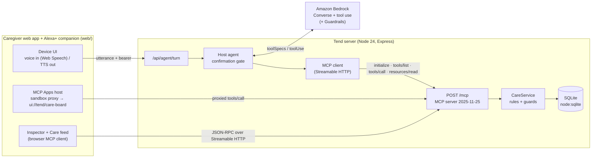

# Tend: a care-circle add-on for Alexa+

**One shared, voice-first medication and care log for families looking after a parent.** It's built as a self-hosted **MCP server** (spec **2025-11-25**, **Streamable HTTP**). The Alexa+ experience is simulated in a web app whose assistant reasons on **Amazon Bedrock**.

> Amazon Developer Hackathon 2026 ("Build, Ship, Shape"). Primary track: **Alexa+**. Mini challenge: **AWS Builder**.

---

## The problem

When two or three siblings share care of a parent, nobody has the full picture:

- *"Did Mom already take her evening metformin? Arjun was there at 8…"* → risk of a **missed dose or a double dose**.
- *"When do we run out of Dad's amlodipine?"* → someone notices on the last pill, and there are **no refills left**.
- *"How was Dad this week?"* → observations live in a WhatsApp thread and get lost before the doctor visit.

A kitchen smart speaker is where these questions are actually asked, often with hands full. Tend gives Alexa+ a persistent, shared memory of the household's care and the guardrails to act on it safely.

## What Tend does

| You say (to Alexa+) | What happens |
|---|---|
| "Did Mom take her pills today?" | Today's schedule per person: taken (by whom, when), **missed**, due now, upcoming. It renders as an interactive card. |
| "I just gave Mom her metformin" | Logs the dose against the nearest scheduled slot and decrements stock. **If a sibling already logged that dose, it refuses and says who logged it and when (double-dose guard).** |
| "When will we run out of anything?" | Forecasts the runout date from stock on hand × schedule and flags anything with no refills left. |
| "Reorder Mom's metformin" → "Yes" | **Two-phase:** it reads a summary and waits for a yes in a *later* turn, then records the refill request and drafts the message to the pharmacy. |
| "Note that Dad felt dizzy after lunch" | Adds an observation that shows up in the handoff report. No interpretation, no advice. |
| "Give me the handoff for this week" | Adherence % per medication, missed doses, notes, low supply and open refills. Useful before a doctor visit or when handing over to a sibling. |

Every caregiver has their own identity (bearer token), so every record says **who** did it. A **view-only** role (e.g. a visiting nurse) can ask questions, but the server doesn't even list write tools to them.

### What makes Tend different

A medication tracker records one person's doses, and a chatbot answers questions. Tend is the **shared, attributed record a family's care circle coordinates through by voice**, and it is enforced on the server, not in the prompt:

- **Two siblings can't double-dose Dad.** `log_dose` refuses a second "taken" for the same slot and says who logged the first one and when (`src/domain/care.ts`). This holds for any MCP client, including an LLM that misunderstands.
- **The model can't approve its own actions.** A refill is prepared, then the host blocks `confirm_action` unless the user said yes *in this turn* to something offered *earlier* (`src/agent/agent.ts`).
- **Roles are structural.** A view-only nurse's MCP session never lists write tools at all (`src/mcp/server.ts`).
- **Honest about uncertainty.** "Did Dad take his pills?" answers from what was logged ("hasn't been logged, so I can't confirm he took it"), never from the schedule; caregiver feelings are never filed as patient notes; observations are saved only after a yes.
- **One standard surface.** The same 13 MCP tools serve Alexa+, the web app, the MCP App views and any other MCP client.

Tend **never gives medical advice**. The rule appears in the MCP server instructions, in the agent's system prompt and, optionally, as an **Amazon Bedrock Guardrail** denied topic.

## How the Alexa+ track requirement is met

- **Self-hosted MCP server**, protocol `2025-11-25` (negotiated in `initialize` and asserted in tests), over **Streamable HTTP** at `POST /mcp`. Implemented with the official `@modelcontextprotocol/sdk` (`src/mcp/server.ts`, `src/http/app.ts`).
- **13 tools** with zod-validated inputs, declared **output schemas** (the SDK validates every `structuredContent` before it leaves the server), and `readOnlyHint`/`destructiveHint` annotations.
- **MCP Apps** (`io.modelcontextprotocol/ui`): status, refill and handoff tools declare `_meta.ui.resourceUri: ui://tend/care-board`, served as `text/html;profile=mcp-app`. The simulator is a real MCP Apps host: it runs a sandbox proxy, the `ui/initialize` handshake, `tool-input`/`tool-result` notifications and proxied `tools/call` (the card's **Mark given** button).
- **Simulated Alexa+ experience** (per the official FAQ): the web app and its Alexa+ companion agent are *real MCP clients*. They send `initialize`, `tools/list` and `tools/call` over Streamable HTTP, and every JSON-RPC message is visible in the **Developer → Traffic** workspace.

## The caregiver app

The web app is a caregiver command center built entirely on Tend's MCP tools. The page itself is an MCP client acting as the selected caregiver, so the server enforces every permission and safety rule.

- **Today:** a plain-language summary of the day; *Needs attention* cards for missed or due doses, low supply and pending confirmations, each with its real action; a per-person **day timeline** (dose markers, a now line, past shading) with an actionable dose list; a 7-day **adherence heatmap** (every scheduled dose, icon + color) with adherence rings; a **supply runway**; and the care-circle activity feed.
- **People:** a profile per care recipient with 7-day adherence, today's progress, next dose, medications (schedule, supply, refills, pharmacy), dose history and a notes timeline. *Add note* and *Add medication* forms call `add_care_note` and `add_medication`.
- **Supply:** runway bars against the 7-day refill point, the **two-step refill** dialog (the server's summary, then confirm or cancel, then the drafted pharmacy message), pickups, and prescriptions with no refills left.
- **Handoff:** a printable report (3/7/14 days) with adherence by medication, dose grid, missed doses, notes, supply and activity. *Print or save PDF* uses a dedicated print stylesheet.
- **Alexa+ companion:** docked on desktop, a bottom sheet on mobile. It handles voice or text, renders MCP Apps cards inline, offers suggestions from live household state, and refreshes the dashboard after every turn.
- **Developer workspace** (kept out of the caregiver flow): protocol overview, a tool catalog with annotations and schemas, an inspector, filterable JSON-RPC traffic with latency, and assistant turn traces.
- **Live sync:** the app polls every 20 s and announces changes made by other caregivers. If a stale screen tries to log a dose someone else already gave, the server's double-dose guard opens a confirmation dialog naming who gave it and when.

## How the assistant works

Every turn: the browser posts the utterance → the host agent opens a real MCP session as that caregiver (`initialize` → `tools/list`) → an **engine** decides which tools to call → each call is a real `tools/call` that passes through the host's confirmation gate and the server's permissions and guards → the reply is returned as display text plus a **spoken form** (units expanded, long drafts left on screen).

**Offline engine (default, no LLM, no AWS).** This is deterministic, not generative, and the UI says so ("Offline router (no LLM)"). `src/agent/intent.ts` classifies intent and extracts entities: people and aliases, medicines, time of day, quantities, hedging and medical-advice questions. `src/agent/offline.ts` is a dialogue manager that:
- greets briefly ("Hey Priya. What can I help you with today?") and lists what it can do only when asked, or after two turns it couldn't follow;
- answers with the **short answer first**: "Did Dad take his pills?" → "Partly. His 6:30 AM Levothyroxine was logged as given at 6:47 AM by Priya. The 9 AM Amlodipine hasn't been logged, so I can't confirm he took it." It never infers a dose from the schedule;
- handles check-ins ("How are Mum's medicines looking?": today's doses, anything not logged, and urgent supply), "what's left today", and **other days** ("What about tomorrow?" reads the schedule for that date; "yesterday" reads what was recorded). It won't log a dose against today when the caregiver says it was yesterday;
- tells the caregiver's own feelings apart from observations about the person they care for. "I am feeling depressed" gets a short, supportive reply and is **never** saved as a note; crisis language gets emergency guidance (988 in the US). "Dad is having a migraine" asks *"Should I add 'Dad is having a migraine' to his notes?"* and saves only after a yes, and only reports it as saved once the server confirms;
- labels every reply with the engine that actually produced it ("Offline router · no LLM" or "Bedrock · <model>"), because a Bedrock setup can fall back to the offline router for a single turn;
- recognises everyday variants of family words ("Mum" for a person filed as "Mom") and uses them back;
- asks a **short clarifying question** for vague requests ("I want to know about the medicine" → "…today, or a particular medicine?") instead of dumping the household's status;
- answers clear questions **directly and narrowly**, using the fewest tool calls (one person's day, one medicine's schedule + supply);
- keeps **conversation context** for follow-ups ("What about tonight?", "And Dad?") and mirrors the family's words ("Mom");
- **never writes on an assumption**: an ambiguous medicine asks "for Mom or Dad?", and a hedged statement ("she probably took it") asks for confirmation before `log_dose`;
- on a possible **double dose**, names who logged it and when, saves nothing, and needs an explicit "a second dose was given" (a bare "yes" isn't enough);
- composes every reply from **verified structured tool results**, explains tool failures plainly, and declines medical-advice questions.

**Amazon Bedrock engine (when AWS credentials are configured).** Replies and tool choices are generated by the model through the Converse tool-use loop. The system prompt carries the same conversational rules (clarify vague requests, stay narrow, resolve ambiguity before writing, no "Of course…" openers). The model can't bypass safety: confirmations are enforced by the host and permissions and the double-dose guard by the server. **Bedrock behavior is only tested with a scripted mock client; live model behavior has not been verified in this repo.**

## The Alexa+ orb and loading

- **Orb** (`web/js/orb.js`, CSS in `styles.css`): a layered glass sphere (halo, shell, drifting conic core, glint, ripple). Its states come only from real events: *idle*, *listening* (only while speech recognition is running), *thinking* (only while a request is in flight), *speaking* (only after the speech engine fires `onstart`; word boundaries add a brief brightening), *success* (only after a write tool returned success), *error* and *unavailable* (desaturated and still when the care record can't be reached). Every state has an accessible label. Reduced motion stops all orb animation. The orb in the composer is the voice control: tap to talk, tap again to stop, tap while speaking to stop speech.
- **Startup screen** (`web/js/boot.js`, `web/js/splash.js`): static markup paints before any JavaScript. On the first visit of a browser session, or with `?intro`, a short introduction (about 1.6 s) plays on the forest brand surface while the orb forms. It leaves once both the introduction and the real startup work are done, and a click or key press skips it once Tend is ready. Return visits show nothing unless startup takes more than about 350 ms. After 6 s it says startup is slow and offers *Try again*; after 20 s, or on any error, it switches to a failure state with a plain message and a focused *Try again*. Reduced motion skips the introduction entirely.
- **Orb ring**: a ring of light circles the sphere. While voice input is active it follows the live microphone level, but only if microphone permission was already granted (so there's never a second prompt); otherwise it uses a CSS ripple. Every orb on the page (composer, empty state, *Ask Alexa+* button) mirrors the assistant's real state.

## How the AWS Builder mini challenge is met

The simulator's assistant runs on **Amazon Bedrock** through the **Converse API with tool use** (`src/agent/bedrock.ts`):

1. Each turn, the agent opens an MCP session and turns Tend's `tools/list` into Bedrock `toolSpec`s.
2. Bedrock (default `us.amazon.nova-pro-v1:0`, configurable) decides which tools to call. Each `toolUse` block becomes a real MCP `tools/call`, and the result goes back as a `toolResult` (speech text plus structured JSON).
3. This loops for up to 6 steps per turn, with conversation history kept per session.
4. Optional **Amazon Bedrock Guardrails**: a denied-topic guardrail (dose changes, interactions, diagnosis). It's created by `npm run guardrail:create` and applied only to the user's words via `guardContent`, so medication names in tool results don't trigger false positives.

Details: [docs/AWS_INTEGRATION.md](docs/AWS_INTEGRATION.md).

## Architecture



More in [docs/ARCHITECTURE.md](docs/ARCHITECTURE.md).

## Quick start

**Prerequisites:** Node.js **24+** (uses built-in `node:sqlite` and native TypeScript type-stripping, so there's no build step). Chrome or Edge for voice input. AWS credentials are optional; see below.

```bash
git clone <this repo> && cd <repo>
npm install
cp .env.example .env        # optional; defaults work for a local demo
npm start
```

Open **http://127.0.0.1:8787**. The first start seeds a demo household: Lakshmi ("Mom") and Ravi ("Dad"), cared for by **Priya** and **Arjun**, plus **Nurse Maria** (view-only), with a week of realistic history.

Tap the ring and speak, or use the suggestion chips. Try this sequence:

1. "Did Mom take her pills today?"
2. "When will we run out of anything?"
3. "Reorder Mom's metformin" → "Yes, go ahead"
4. Open a second browser window (or a private window), switch the caregiver menu to **Arjun**, and press *Mark given* on a dose Priya just gave in the first window: the double-dose guard stops it and names Priya
5. "Note that Dad felt dizzy after lunch" → "Give me the handoff for this week"
6. Switch to Nurse Maria → try to log a dose (it's refused; view-only)

Without AWS credentials the header shows **"Offline router (no LLM)"**: a small deterministic intent parser that still goes through the real MCP client. Add credentials to use Bedrock.

### Using Amazon Bedrock

1. In the AWS console, open **Amazon Bedrock → Model access** in your region (e.g. `us-east-1`) and make sure the model is available (default: Amazon Nova Pro). Any Converse model with tool use works via `BEDROCK_MODEL_ID`.
2. Give the IAM identity `bedrock:InvokeModel` on that model or inference profile (plus `bedrock:ApplyGuardrail` if using a guardrail).
3. Configure credentials using the standard AWS chain (`aws configure`, `AWS_PROFILE`, or env vars), then set `AWS_REGION`.
4. Verify: `npm run smoke:bedrock` (one Converse call with a tool; prints the stop reason, whether tool use worked, and tokens).
5. Optional guardrail: `npm run guardrail:create`, then put the printed `BEDROCK_GUARDRAIL_ID` and `BEDROCK_GUARDRAIL_VERSION` in `.env`.
6. `npm start`. The badge should read **Amazon Bedrock · <model>**.

Cost: each turn is typically 2–3 Converse calls with a few thousand input tokens (mostly tool definitions). Nothing runs when you're not using it.

### Connecting another MCP client

Set `TEND_CAREGIVERS` in `.env` (see `.env.example`) so you know a token, restart, then point any Streamable HTTP MCP client at `http://127.0.0.1:8787/mcp` with header `Authorization: Bearer <token>`. For example, with the MCP Inspector:

```bash
npx @modelcontextprotocol/inspector
# Transport: Streamable HTTP · URL: http://127.0.0.1:8787/mcp · add the Authorization header
```

Raw JSON-RPC also works:

```bash
curl -s http://127.0.0.1:8787/mcp \
  -H "Authorization: Bearer $TOKEN" -H "Content-Type: application/json" \
  -H "Accept: application/json, text/event-stream" \
  -d '{"jsonrpc":"2.0","id":1,"method":"initialize","params":{"protocolVersion":"2025-11-25","capabilities":{},"clientInfo":{"name":"curl","version":"1"}}}'
```

## MCP tools

| Tool | Kind | Notes |
|---|---|---|
| `list_care_recipients` | read | People, aliases, medications, schedules, supply |
| `get_care_status` | read · **MCP App** | Taken / missed / due / upcoming per slot; supply alerts; pending confirmations |
| `forecast_refills` | read · **MCP App** | Days left, runout date, urgency, advice |
| `get_handoff_report` | read · **MCP App** | Adherence, missed doses, notes, alerts, open refills |
| `get_recent_activity` | read | Who did what |
| `log_dose` | write | Slot matching (incl. past-midnight), double-dose guard, stock tracking |
| `request_refill` | write | Step 1 of 2: creates a pending action (15-minute expiry) |
| `confirm_action` | write · destructive | Step 2 of 2: single use, compare-and-set |
| `cancel_action` | write | |
| `record_refill_pickup` | write | Adds stock, closes the open refill |
| `add_care_note` | write | Observation / symptom / appointment |
| `add_medication`, `add_care_recipient` | write | Setup |

Write tools are only registered for `caregiver` tokens.

## Configuration

All settings are environment variables; see [`.env.example`](.env.example).

| Variable | Default | Purpose |
|---|---|---|
| `HOST` / `PORT` | `127.0.0.1` / `8787` | Bind address |
| `TEND_DB_PATH` | `./data/tend.db` | SQLite file |
| `TEND_TIMEZONE` | system timezone | Household timezone for dose times |
| `TEND_CAREGIVERS` | 3 demo users, random tokens | `id\|Name\|caregiver\|viewer\|token,…` |
| `TEND_SESSION_SECRET` | random per process | HMAC key for short-lived browser tokens |
| `TEND_DEMO_MODE` | on when loopback | Enables `/api/demo/session` and `/api/demo/reset` |
| `TEND_ALLOWED_ORIGINS` | none | Extra browser origins |
| `TEND_AGENT_ENGINE` | `auto` | `auto` / `bedrock` / `offline` |
| `AWS_REGION` | `us-east-1` | Bedrock region |
| `BEDROCK_MODEL_ID` | `us.amazon.nova-pro-v1:0` | Any Converse model with tool use |
| `BEDROCK_GUARDRAIL_ID` / `_VERSION` | none | Optional guardrail |

## Scripts

```bash
npm start              # server + caregiver app
npm run dev            # same, restarts on file changes
npm test               # 147 automated tests (node:test)
npm run typecheck      # tsc --noEmit (strict)
npm run check          # both
npm run seed           # reset the local DB to the demo household
npm run smoke:bedrock  # verify Bedrock access + tool use
npm run guardrail:create
```

## Tests

`npm test` runs domain, protocol, agent and security tests against the **real HTTP server** on an ephemeral port:

- **Domain** (`test/care.test.ts`, `test/time.test.ts`): slot matching (incl. 00:30 → yesterday's 20:00), the double-dose guard, stock math, status classification at fixed clock times, forecast, two-phase confirm/expiry/cancel, handoff adherence, name resolution, and DST/half-hour-offset timezones.
- **MCP e2e** (`test/mcp.e2e.test.ts`): protocol `2025-11-25` negotiation with the official SDK client, role-scoped `tools/list`, output schemas, `isError` vs JSON-RPC errors, the MCP Apps resource MIME type, 401 + `WWW-Authenticate`, Origin/Host (DNS rebinding) rejection, 405 on GET, session tokens.
- **Agent** (`test/agent.test.ts`): wire order `initialize → notifications/initialized → tools/list → tools/call`, the refill flow across turns, a cross-caregiver double dose, the viewer refusal, and the **Bedrock Converse loop with a scripted mock client**. That includes a model trying to self-confirm a refill in the same turn, which the host policy blocks, and guardrail `guardContent` scoping.

- **Web app** (`test/web.test.ts`): strict CSP and same-origin assets only, the full ES-module import graph and WOFF2 fonts resolve, the MCP Apps sandbox proxy forbids network access, and the handoff report's per-day dose grid is schema-validated over MCP.

- **Conversation** (`test/conversation.test.ts`): intent classification, clarification for vague questions, person-scoped answers, follow-ups that reuse context, ambiguous writes that ask first, hedged statements that aren't logged, duplicate doses needing an explicit second confirmation, refill offers that only *prepare* a request, medical-advice refusal, plain-language tool failures, and the spoken form.

Bedrock is mocked in automated tests. Live Bedrock is verified with `npm run smoke:bedrock` and manual runs (see [docs/FRICTION_LOG.md](docs/FRICTION_LOG.md) for what was observed).

## Security

- **Auth:** per-caregiver bearer tokens (≥ 24 chars, constant-time comparison). The browser only ever gets **1-hour HMAC-signed session tokens**. `/api/config` never returns tokens.
- **Authorization:** role-scoped tool registration (viewers never see write tools) plus checks in the service layer.
- **Consequential actions:** two-phase with expiry and single-use compare-and-set. The **host** blocks `confirm_action` unless the user said yes *in this turn* to an action offered *in an earlier turn*, so the model can't self-confirm.
- **Transport:** Host-header allowlist on loopback and Origin check (DNS-rebinding protection from the Streamable HTTP spec), 100 kB body limit, rate limiting, and 405 for GET/DELETE.
- **Output:** no stack traces or SQL errors reach clients. Domain errors are typed (`NOT_FOUND`, `AMBIGUOUS`, `CONFLICT`, …).
- **Web:** strict CSP (`script-src 'self'`). MCP App views run in a double sandbox (opaque-origin iframe, CSP `default-src 'none'`, so a view can't make network requests). Only an allowlist of tools can be called from a view.
- **Secrets:** `.env` is git-ignored, and nothing logs tokens.

## Limitations (honest)

- **No real Alexa+ device.** Amazon's Alexa+ add-on tooling (MCP Toolkit, Web Simulator) is preview/select-partner only, so the experience is simulated per the official FAQ.
- **Pharmacy integration is not real.** A confirmed refill is recorded for the care circle and a pharmacy message is *drafted*; nothing is sent to a pharmacy.
- **Auth is static bearer tokens, not OAuth 2.1** as the MCP authorization spec recommends for remote servers. That's fine for a household server on a LAN or tunnel, but not for a multi-tenant service.
- **Single household per database**, SQLite storage. Deploying to AWS Lambda would need a DynamoDB-backed store (the `Store` class is the seam).
- Voice input uses the browser's Web Speech API (Chrome/Edge). Typing works everywhere.

## Project layout

```
src/
  domain/   time.ts (Intl-only TZ math) · store.ts (node:sqlite) · care.ts (business rules)
  mcp/      server.ts (tools/resources) · schemas.ts (output schemas) · ui/care-board.html (MCP App)
  agent/    agent.ts (host + policy) · mcpClient.ts · bedrock.ts · offline.ts
  http/     app.ts (Express, /mcp, /api) · auth.ts
  index.ts  seed.ts  config.ts
web/        index.html · styles.css (design system) · mcp-browser.js · sandbox-proxy.html · fonts/ (OFL)
  js/       app.js (shell, router, live sync) · api.js (MCP data layer) · actions.js · charts.js (SVG/grid visuals)
            assistant.js (Alexa+ companion + MCP Apps host) · ui.js · views/{today,people,supply,handoff,developer}.js
test/       node:test suites + real-server harness
scripts/    seed · bedrock-smoke · create-guardrail
docs/       ARCHITECTURE · AWS_INTEGRATION · PRODUCT_FEEDBACK · FRICTION_LOG · DEMO_SCRIPT · SUBMISSION_CHECKLIST · TEE_ASSESSMENT (investigation only; Tend does not run in a TEE)
```

## Disclaimer

Tend is not a medical device and doesn't provide medical advice. It's an unofficial hackathon project and isn't affiliated with or endorsed by Amazon. "Alexa" is a trademark of Amazon.com, Inc. or its affiliates. Demo people and pharmacies are fictional.

## License

[MIT](LICENSE)

Fonts in `web/fonts/` (Newsreader, Instrument Sans, JetBrains Mono) are licensed under the SIL Open Font License 1.1; their license texts are included alongside them.
